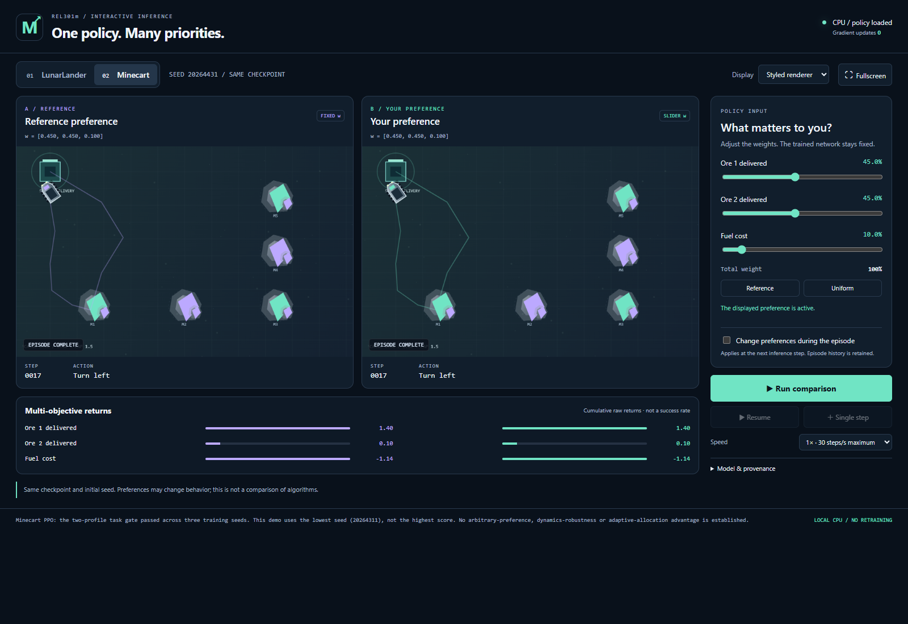

# Preference-Conditioned Multi-Objective Reinforcement Learning

**REL301m | Reinforcement Learning | FPT University | Fall 2026**

A multi-objective reinforcement learning (MORL) project on **Minecart** and
**MO-LunarLander**. Policies receive both an environment observation and a
preference vector `w`, allowing one trained network to represent different
objective trade-offs.

The repository includes PCQN and PPO implementations, fixed experiment
protocols, tests, versioned result evidence, an **English interactive demo** and
an **English course report with editable LaTeX source**.

The original research question concerns adaptive allocation toward difficult,
uncertain or learnable preference regions. **An adaptive-allocation advantage
has not been established.** The later PPO studies support specific task gates,
with their scope and limitations stated below.

## Start here

- [English submission and delivery guide](docs/course/ENGLISH_DELIVERY_20261112.md)
- [Course report and editable-source build instructions](paper/REL301m/BUILD_ENGLISH.md)
- [English demo user guide](demo/interactive/README_EN.md)
- [Installation and reproduction boundaries](docs/REPRODUCIBILITY.md)
- [Documentation map](docs/README.md)

The current report contains **26 pages**, with architecture diagrams,
data-derived learning curves, result tables, a preference-diagnosis heatmap and
real screenshots of the English demo. Generated PDFs, ZIPs and pretrained
checkpoints are local artifacts; they are not included in a source-only clone.

## Problem and features

- **Minecart:** trade off two delivered ore objectives against fuel cost.
- **MO-LunarLander:** trade off landing outcome, shaping and two engine-cost
  components in a four-dimensional reward vector.
- Preference-conditioned vector Q-network with masked heads, per-head
  Double-DQN targets and replay that preserves behavior preferences and end flags.
- Curriculum signals based on conditioning gap, head disagreement, local
  coverage/recency and observed learning progress.
- Categorical PPO with a vector critic and PopArt; Lunar uses a separate
  GAE-based implementation.
- Evaluation of utility, Pareto fronts and hypervolume, retaining raw and
  discounted vector returns, seeds, budgets, hashes and provenance.
- Two-panel inference demo with preference sliders, pause/resume, single-step
  control, original environment rendering and JSON trace export.
- A research harness for claims, experiments, literature, sessions and an
  evidence-gated roadmap.

## Architecture


Fixed protocols define preferences, reward scales, seeds and budgets. PCQN
learns vector values from replay and can adapt the preference sampling
distribution. PPO updates an actor and vector critic from collected rollouts.
Both paths use environment wrappers and record provenance. The demo loads
exported policy weights and performs inference only.

Implementation contracts:
[PCQN architecture](docs/ARCHITECTURE.md),
[Minecart PPO](docs/research/ONPOLICY_IMPLEMENTATION_V1.md),
[Lunar PPO](docs/research/LUNAR_PPO_SPECIALIST_V1.md).

## Recorded results

These are existing development/validation results recorded on **3 November
2026**, not new experiments or final-test results.

| Study | Final-checkpoint outcome | Evidence |
|---|---|---|
| Minecart PPO confirmation: 3 fresh training seeds, 4M interactions per seed | Each seed achieved 10/10 deliveries in every cell of 2 task profiles x 2 inference modes (sampled and argmax). | [Results and limits](docs/research/ONPOLICY_CONFIRMATION_RESULTS_20261103.md), [raw evidence](research/evidence/minecart_onpolicy_confirmation_v1.json) |
| Lunar PPO confirmation: 2 fresh training seeds, 4M interactions per seed | Each seed achieved 10/10 native pad landings at the trained preference `[.7,.1,.1,.1]`, in both inference modes. | [Results and limits](docs/research/LUNAR_CONFIRMATION_RESULTS_20261103.md), [raw evidence](research/evidence/lunar_onpolicy_confirmation_v1.json) |
| Historical PCQN and Minecart remediation studies | The specified qualification gates failed. Negative results are retained. | [Research status](docs/research/PROJECT_STATUS.md), [F1 qualification](research/qualification/minecart_pcqn_replay_f1.json) |

A 10/10 result describes the specified cases; it is not a universal success-rate
guarantee. Arbitrary-preference competence, dynamics robustness and adaptive
superiority remain unestablished. Phase 4 is active, and the original matrix and
final-test gates remain locked.

The demo's Lunar actor is specialist pilot seed `20265311`; the two prospective
Lunar confirmation models are reported separately. Minecart uses confirmation
seed `20264311`, selected by the predeclared lowest-seed rule.

## Technology

Python **3.11**, PyTorch, Gymnasium, MO-Gymnasium, Box2D/Pygame, NumPy, SciPy,
Pymoo, MORL-Baselines and TensorBoard/W&B. The local demo uses a Python HTTP
server and HTML/CSS/JavaScript Canvas. Node/npm is not required for inference.

Quality tools: Pytest, Ruff, MyPy and Bandit. Direct dependencies are pinned in
[requirements.txt](requirements.txt); [pyproject.toml](pyproject.toml) configures
checks. Direct pins are not a complete transitive dependency lockfile.

## Research environment setup

Use a dedicated **Python 3.11** environment on Linux/WSL Ubuntu. Keep Windows
and Linux environments separate, and do not install project dependencies into
conda base or the operating system's Python.

```bash
git clone https://github.com/Am2uocVi3t/REL301m_AdaptivePreferenceMORL.git
cd REL301m_AdaptivePreferenceMORL

# Ubuntu: system-package installation requires appropriate permissions.
# A Python 3.11 interpreter must already be available.
sudo apt-get install build-essential swig libcdd-dev
python3.11 -m venv .venv
source .venv/bin/activate
python -m pip install --upgrade pip
python -m pip install -r requirements.txt

python scripts/research_harness.py doctor
python scripts/research_harness.py status
python scripts/research_harness.py roadmap list
```

If Box2D builds from source, its Python development headers must match the
interpreter. GPI-LS requires `libcdd-dev` for `pycddlib`. Ubuntu 24.04 normally
ships Python 3.12; the commands above do not install Python 3.11 for you.

The latest verification reused an existing Windows Python 3.11.18 demo runtime
with isolated QA dependencies. A clean installation of the entire Linux
research stack was not repeated. See [reproduction notes](docs/REPRODUCIBILITY.md)
for the exact distinction.

## Testing

From the repository root with the intended environment activated:

```bash
python -m ruff format --check .
python -m ruff check .
python -m mypy src scripts
python -m pytest -q
python -m bandit -q -r src scripts -ll
python -m compileall -q src scripts tests
git diff --check
```

The English delivery recorded **235 passing Python tests and 4 skips**,
**81 frontend assertions**, Ruff checks on 190 tracked/new Python files,
MyPy on 148 source files, and passing Bandit/compileall checks.
See the [delivery receipt](research/qualification/english_course_delivery_20261112.json)
for scope. Three skipped ARIS modules need Unix, and one integration test needs
missing historical checkpoints. Existing uncommitted team work can affect
whole-working-tree checks.

Tests using synthetic weights verify implementation behavior; they do not
establish learned policy quality.

## Optional engineering smoke run

The following creates a **new engineering smoke artifact**, not reportable
research evidence. Run it only when you need to verify the installed pipeline:

```bash
python scripts/train.py \
  --env mo-lunar-lander-v3 \
  --protocol configs/protocols/course_mo_lunar_lander_v3.json \
  --algo uniform-pcqn \
  --seed 42 \
  --total-timesteps 10000 \
  --learning-starts 1000 \
  --output-dir artifacts/local-smoke

python scripts/evaluate.py \
  --model-path artifacts/local-smoke/uniform-pcqn_mo-lunar-lander-v3_seed42/final.pt \
  --protocol configs/protocols/course_mo_lunar_lander_v3.json \
  --split validation \
  --episodes-per-preference 1 \
  --shift nominal \
  --output results/local-smoke_validation.json
```

Do not restart completed studies to replace missing checkpoints. Research
cohorts require their own frozen plans, authorization and qualification gates.

## Run the English demo

**A fresh Git clone does not include pretrained weights or `outputs/`.**
Use the verified English package, or supply the corresponding audited
artifacts. No public checkpoint download has been verified for this release.

Current local package: `outputs/REL301m_English_Demo_20261112/`.
From that package directory, using Python 3.11 with its dependencies installed:

```bash
python launch.py --port 8765
```

Open `http://127.0.0.1:8765`. Choose an environment, adjust preferences and select
**Run comparison**. **Pause**, **Resume** and **Single step** expose individual
actions. **Native renderer** shows the original environment graphics.
Live preference changes retain episode history; reset before comparing from
matched initial states. Stop the server with `Ctrl+C`.

On the prepared Windows laptop, [START_COURSE_DEMO.bat](START_COURSE_DEMO.bat)
prefers the English package and finds an available port. Its PowerShell launcher
uses `REL301M_PYTHON` when set, the checkout's Windows virtual environment when
available, or the existing standalone demo interpreter. It is not an installer
for a fresh clone.



The screenshot is an interface/inference witness, not a new task-performance
experiment. Both panels use the same frozen actor. See the
[English user guide](demo/interactive/README_EN.md) for a complete walkthrough.

## Report and editable source

Active LaTeX source: [paper/REL301m/main.tex](paper/REL301m/main.tex).
Build instructions: [BUILD_ENGLISH.md](paper/REL301m/BUILD_ENGLISH.md).

With project plotting dependencies and an existing Tectonic installation:

```bash
python scripts/build_english_report.py --compiler /path/to/tectonic
```

This reads existing evidence, generates plots, audits report inputs, compiles
the PDF and packages editable sources. It performs no training or final test.

Generated outputs:

- `outputs/english-course-report-20261112/REL301m_English_Course_Report.pdf`
- `outputs/english-course-report-20261112/REL301m_English_Report_Editable_Source.zip`

The editable ZIP includes the figure assets needed to compile the report
without obtaining model checkpoints. The
[English delivery guide](docs/course/ENGLISH_DELIVERY_20261112.md)
describes the prepared laptop handoff.

## Repository layout

```text
src/          models, replay, curriculum, environments, evaluation, demo, harness
scripts/      training, evaluation, audits, qualification, packaging and report tools
configs/      algorithms, fixed protocols, shifts, experiment plans and runtime specs
tests/        invariant, integration, demo, recovery and provenance tests
demo/         current frontend and historical demo templates
research/     claims, experiments, raw-result evidence, qualification and sessions
docs/         architecture, operational guides, course material and archives
paper/        editable report sources and figures
monitor/      native training terminal and monitoring utilities
.agents/      agent bootstrap, memory and research workflows
artifacts/    local checkpoints, caches and runtime files (ignored)
outputs/      generated reports and delivery packages (ignored)
```

[Documentation map](docs/README.md) |
[Course hub](docs/course/README.md) |
[Repository review](docs/REPOSITORY_REVIEW.md) |
[Agent instructions](AGENTS.md).

## Team and course

- **Huynh Quoc Viet** - Team lead.
- **Le Nguyen Gia Hung** - Project introduction and demonstration.
- **Ngo Hoai Nam** - Experiments and critical analysis.
- **Lecturer:** Luu Giang Nam.
- **Course:** REL301m - Reinforcement Learning, FPT University.

Names and roles follow the existing course records.

## Delivery scope and limitations

The confirmed deliverables are the repository, the English inference demo and
the English PDF report with editable source. No video is required; the apparent
video request was clarified as a dictation error. No additional slide deck or
new research training is part of this edition.

Historical research records, the original submitted proposal, pinned upstream
agent skills and preexisting team drafts are retained for provenance. Some
original records are in Vietnamese; they are not the current English submission
entry points. [English documentation coverage](docs/ENGLISH_DOCUMENTATION.md)
identifies the current guides and the preserved originals explicitly.

Future research needs a separately scoped comparison of uniform, matched-random
and adaptive allocation, plus broader preference/dynamics evaluation. Existing
task confirmation does not complete that comparison.
