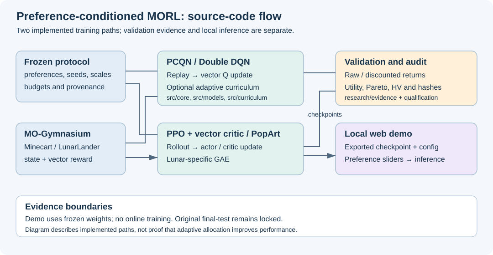

# Preference-Conditioned Multi-Objective Reinforcement Learning

**REL301m · Reinforcement Learning · FPT University · Fall 2026**

Dự án nghiên cứu học tăng cường đa mục tiêu (MORL) trên **Minecart** và
**MO-LunarLander**. Chính sách nhận trạng thái môi trường cùng vector ưu tiên
`w` để chọn hành động theo sự đánh đổi giữa các mục tiêu.

Repo gồm mã huấn luyện, kiểm thử, protocol cố định, bằng chứng thực nghiệm và
web demo suy luận từ checkpoint. Mục tiêu ban đầu là phân bổ việc học vào các
vùng preference khó; lợi ích của phân bổ thích nghi **chưa được chứng minh**.
Kết quả PPO hiện có hỗ trợ một phạm vi hoàn thành tác vụ cụ thể.

## Bài toán và chức năng

- **Minecart:** cân bằng hai loại quặng được vận chuyển về trạm và chi phí nhiên liệu.
- **MO-LunarLander:** cân bằng hạ cánh, shaping và chi phí động cơ trong reward vector bốn chiều.
- Vector Q-network có điều kiện theo preference, masked multi-head Double DQN,
  replay và curriculum theo gap, uncertainty, coverage/recency, progress.
- PPO với vector critic và PopArt; Lunar dùng thêm GAE.
- Đánh giá utility, Pareto front, hypervolume; lưu raw/discounted vector returns,
  seed, budget và hash để đối chiếu.
- Demo hai panel dùng cùng model và seed; đổi preference, pause/step, xem
  renderer gốc và xuất trace. Demo chỉ chạy inference.
- Research harness quản lý claims, experiments, literature và roadmap.

## Kiến trúc và luồng hoạt động



Protocol cố định preference, reward scale, seed và budget. PCQN cập nhật vector
Q từ replay và có thể điều chỉnh phân phối preference bằng curriculum. PPO
cập nhật actor và vector critic từ rollout. Hai nhánh dùng wrapper môi trường
và lưu provenance; demo nạp trọng số đã xuất để suy luận.

Chi tiết: [kiến trúc PCQN](docs/ARCHITECTURE.md),
[PPO Minecart](docs/research/ONPOLICY_IMPLEMENTATION_V1.md),
[PPO Lunar](docs/research/LUNAR_PPO_SPECIALIST_V1.md).

## Kết quả đã ghi nhận

Các số dưới đây lấy từ bằng chứng development/validation đã version hóa ngày
03/11/2026; đây không phải lần chạy mới hay kết quả trên final-test.

| Phạm vi | Kết quả tại checkpoint cuối | Bằng chứng |
|---|---|---|
| Minecart PPO, 3 training seeds mới, 4M interactions/seed | Mỗi seed đạt 10/10 deliveries ở từng tổ hợp của 2 task profiles × 2 chế độ sampled/argmax | [Kết quả và giới hạn](docs/research/ONPOLICY_CONFIRMATION_RESULTS_20261103.md) · [Raw evidence](research/evidence/minecart_onpolicy_confirmation_v1.json) |
| Lunar PPO, 2 training seeds xác nhận mới, 4M interactions/seed | Mỗi seed đạt 10/10 hạ cánh trong pad ở trained preference `[.7,.1,.1,.1]`, trong cả hai chế độ | [Kết quả và giới hạn](docs/research/LUNAR_CONFIRMATION_RESULTS_20261103.md) · [Raw evidence](research/evidence/lunar_onpolicy_confirmation_v1.json) |
| PCQN và các thử nghiệm khắc phục Minecart | Không qua các qualification gates định trước; giữ nguyên kết quả âm | [Trạng thái](docs/research/PROJECT_STATUS.md) · [F1 qualification](research/qualification/minecart_pcqn_replay_f1.json) |

10/10 là kết quả trên các trường hợp chỉ định, không bảo đảm thành công ở mọi
preference/seed. Chưa có kết luận ưu thế adaptive allocation, tổng quát mọi
preference hay độ bền khi đổi dynamics. Phase 4 vẫn active; matrix gốc và
final-test còn khóa. Demo Lunar dùng pilot seed `20265311`, tách biệt với hai
seed xác nhận trong bảng.

## Công nghệ

Python **3.11**, PyTorch, Gymnasium, MO-Gymnasium, Box2D/Pygame, NumPy/SciPy,
Pymoo, MORL-Baselines, TensorBoard/W&B. Demo dùng Python HTTP server và
HTML/CSS/JavaScript Canvas, chạy local; không cần Node/npm cho inference.
Pytest, Ruff, MyPy và Bandit kiểm tra chất lượng mã.

Dependency trực tiếp được pin trong [requirements.txt](requirements.txt);
[pyproject.toml](pyproject.toml) cấu hình kiểm thử và static analysis.
Đây chưa phải lockfile đầy đủ cho dependency bắc cầu.

## Cài đặt môi trường nghiên cứu

Ưu tiên Linux/WSL Ubuntu với **Python 3.11** riêng cho dự án. Không dùng conda
base hoặc chia sẻ môi trường giữa Windows và Linux.

```bash
git clone https://github.com/Am2uocVi3t/REL301m_AdaptivePreferenceMORL.git
cd REL301m_AdaptivePreferenceMORL

# Ubuntu: cần quyền cài dependency hệ thống; python3.11 phải có sẵn.
sudo apt-get install build-essential swig libcdd-dev
python3.11 -m venv .venv
source .venv/bin/activate
python -m pip install --upgrade pip
python -m pip install -r requirements.txt

python scripts/research_harness.py doctor
python scripts/research_harness.py status
python scripts/research_harness.py roadmap list
```

Python development headers phải khớp interpreter nếu Box2D cần build. GPI-LS
cần `libcdd-dev` cho `pycddlib`. Ubuntu 24.04 mặc định dùng Python 3.12, vì vậy
cần chuẩn bị Python 3.11 trước; các lệnh trên không tự cài interpreter này.
Xem [hướng dẫn tái lập và giới hạn môi trường](docs/REPRODUCIBILITY.md).

### Kiểm thử

Từ thư mục gốc, sau khi kích hoạt môi trường:

```bash
python -m ruff format --check .
python -m ruff check .
python -m mypy src scripts
python -m pytest -q
python -m bandit -q -r src scripts -ll
python -m compileall -q src scripts tests
git diff --check
```

Các test dùng dữ liệu/weights tạm không xác nhận chất lượng model đã học.
Một số test cần artifact lịch sử hoặc Unix; khi skip phải ghi rõ lý do.

### Chạy thử pipeline PCQN

Lệnh sau tạo **engineering smoke run mới**, không dùng để báo cáo kết quả.
Chỉ chạy khi cần xác minh pipeline và đã cài đủ dependency:

```bash
python scripts/train.py \
  --env mo-lunar-lander-v3 \
  --protocol configs/protocols/course_mo_lunar_lander_v3.json \
  --algo uniform-pcqn \
  --seed 42 \
  --total-timesteps 10000 \
  --learning-starts 1000 \
  --output-dir artifacts/local-smoke

python scripts/evaluate.py \
  --model-path artifacts/local-smoke/uniform-pcqn_mo-lunar-lander-v3_seed42/final.pt \
  --protocol configs/protocols/course_mo_lunar_lander_v3.json \
  --split validation \
  --episodes-per-preference 1 \
  --shift nominal \
  --output results/local-smoke_validation.json
```

Không tự chạy lại các nghiên cứu đã hoàn thành để lấy checkpoint. Việc chạy
PPO và cohort nghiên cứu phải tuân theo plan/gate riêng trong
[tài liệu tái lập](docs/REPRODUCIBILITY.md).

## Sử dụng demo

**Bản clone Git không chứa checkpoint hay gói `outputs/`.** Các test demo dùng
fixture; để xem model thực đã huấn luyện cần gói demo đã kiểm chứng hoặc artifact
nguồn tương ứng. Hiện chưa có đường tải công khai được xác minh cho gói này.
Inference không cần API key hay dịch vụ trả phí.

Gói local mới nhất có bằng chứng kiểm tra là
`outputs/REL301m_Course_Reference_Review_20261103/`;
[receipt](research/qualification/research_reference_delivery_20261103.json)
ghi phạm vi kiểm chứng lịch sử. Gói có `config.json`, `checkpoints/`, `website/`,
`src/` và `launch.py`. Từ thư mục gói, với Python 3.11 và dependency đã cài:

```bash
python launch.py --port 8765
```

Mở `http://127.0.0.1:8765`, chọn môi trường, kéo preference rồi bấm **Chạy so sánh**.
Pause/step giúp quan sát từng hành động; renderer gốc cho phép đối chiếu mô phỏng.
Live-mode giữ lịch sử episode khi đổi preference nên hai panel có thể đã đi qua
trạng thái khác nhau. Dừng server bằng `Ctrl+C`.

Trên Windows đã có runtime/gói local đúng đường dẫn,
[`START_COURSE_DEMO.bat`](START_COURSE_DEMO.bat) gọi launcher hiện có và tìm cổng
trống. Launcher này không phải installer cho bản clone mới. Xem
[hướng dẫn demo](demo/interactive/README_VI.md) và
[ghi chú Windows lịch sử](docs/WINDOWS_RECOVERY.md).

## Cấu trúc thư mục

```text
src/          models, replay, curriculum, env wrappers, evaluation, demo, harness
scripts/      train/evaluate, audit, qualification, packaging và CLI nghiên cứu
configs/      algorithm, protocols, shifts, plans và runtime specifications
tests/        invariant, integration, demo và recovery tests
demo/         frontend, launcher và template các giai đoạn demo
research/     claims, experiments, raw-result evidence, qualification, sessions
docs/         kiến trúc, hướng dẫn, trạng thái, course và archive
paper/        nguồn báo cáo đã có; chưa xác nhận định dạng nộp cuối kỳ
monitor/      terminal monitor và tiện ích theo dõi job
.agents/      bootstrap, memory và workflow hỗ trợ nghiên cứu
artifacts/    checkpoint/cache/runtime local — không nằm trong Git
outputs/      gói xuất và bản dựng local — không nằm trong Git
```

[Bản đồ tài liệu](docs/README.md) · [Khảo sát và biên bản chuẩn hóa](docs/REPOSITORY_REVIEW.md)
· [Hướng dẫn cho coding agents](AGENTS.md).

## Nhóm thực hiện

- Huỳnh Quốc Việt — Trưởng nhóm.
- Lê Nguyễn Gia Hưng — Dẫn dắt và demo.
- Ngô Hoài Nam — Thực nghiệm và phản biện.
- Giảng viên hướng dẫn: Thầy Lưu Giang Nam.

Thông tin nhóm theo tài liệu course hiện có. Môn học: **REL301m — Reinforcement Learning**.

## Phạm vi bàn giao và backlog

Đầu ra hiện tại là **repository để nộp giảng viên**. Giữ lại tài liệu/báo cáo và
tài sản thuyết trình đã có; phiên chuẩn hóa này không tạo hay xuất thêm các gói đó.

- Chờ xác nhận định dạng report cuối kỳ: **slide hay PDF**, nội dung và thời điểm.
- Video demo: thực hiện sau khi được yêu cầu.
- Nếu giảng viên cần chạy model ngay từ link repo: thống nhất cách cung cấp gói
  demo/checkpoint đã kiểm chứng; hiện các artifact này chỉ có local.
- Hướng nghiên cứu tiếp: so sánh uniform/random/adaptive với budget khớp và mở
  rộng preference/dynamics theo protocol riêng; chưa phải kết quả hiện có.
