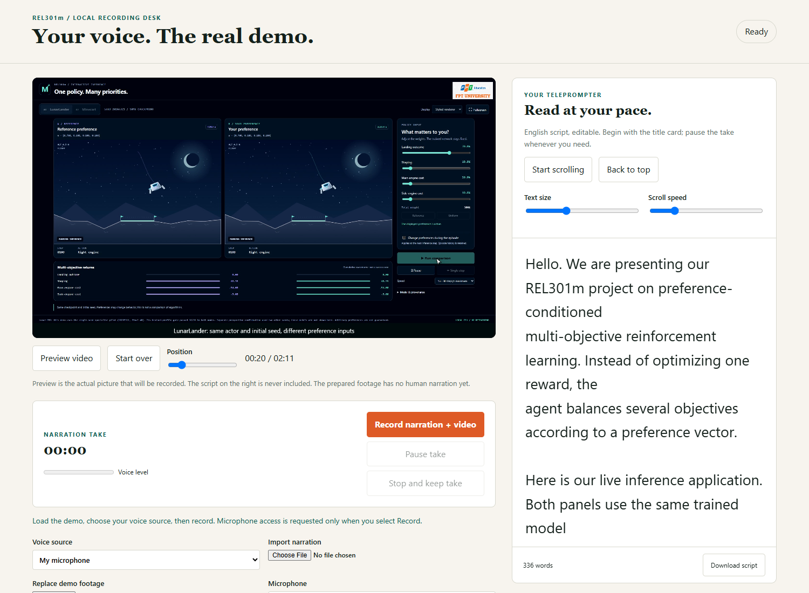

# English video and narration workspace

The video shows real interaction with the existing frozen PPO demo. It does not
train models or provide new task-performance evidence. The initial MP4 is a
captioned demonstration prepared for the user's own narration, not an AI voice.



## Recording desk

Run `python scripts/recording_studio.py --media outputs/video-course-20261112/demo.mp4`.
Use Python 3.11+ and an FFmpeg executable. Set `FFMPEG_PATH`, or install
`imageio-ffmpeg==0.6.0` into that Python. The server itself uses only the Python
standard library.

```bash
python -m pip install imageio-ffmpeg==0.6.0
```
Open the localhost address printed by the server in Chrome or Edge. The page
provides an editable English script, adjustable teleprompter, microphone recording,
take playback/download, imported audio, optional background music and local MP4
export. See the desk's inline instructions for the recording sequence.

Select **Record narration** to grant microphone access and start reading while
the demonstration plays. The script is outside the video and is never captured
as part of the picture. **Stop and keep take** retains the recording locally;
listen before exporting. Audio stays on the machine. Export sends the selected
take only to the localhost server, which uses FFmpeg to make H.264/AAC MP4.
Keep the raw take until satisfied with the export. No automatic publishing.

Record starts the teleprompter automatically from the first word. The current
word is highlighted and kept in view as you read. Set **Reading pace** in words
per minute (default 155). **Pause take** freezes both video and reading position;
resume continues together. **Start teleprompter** is also available for rehearsal
without recording. Pause it to edit the script; **Back to top** resets the cue.
Highlighting follows the selected timing, not speech recognition. No narration
is sent to a speech service. Open the launcher/localhost website, not the HTML
file directly; the latter now shows an explicit startup guide.

## Export controls and limits

The default master is 1920x1080 at 30 fps. Voice cleanup uses a gentle high-pass
and noise reduction followed by loudness control; listen for artifacts. Optional
quiet background music is ducked beneath narration. The included ambient bed is
an original locally synthesized track; a user-selected music file is also allowed.
Codec/container metadata and decoded frames/audio are checked after export.

Microphone availability and final voice quality must be checked with the actual
user and device. Automated tests use synthetic audio and do not certify a real
microphone. Recording longer than the demonstration is allowed: the final frame
is held until **Stop and keep take**, so the end of your narration is retained.

The report+slide ZIP has a 10 MB Form limit. Keep the high-quality MP4 separate
until a video delivery destination is agreed. Do not reduce the only master to
fit that ZIP or publish it to a third party automatically.

## Sources and tools

`SCRIPT_EN.md` and `storyboard.json` define the narration and ordered actions.
`demo/recording/` contains the editable desk UI. `scripts/record_demo_video.cjs`
uses the UI Demo skill's discover/rehearse/record workflow with real Playwright
browser interaction. FFmpeg handles encoding, mixing and media validation.
Webreel, UI Demo, Remotion and FFmpeg skills were installed from pinned upstream
sources. This small local workflow reuses the available Edge/Playwright runtime
and does not require installing a second video-composition framework.

## Prepared release and verification

The local master is `outputs/video-course-20261112/demo.mp4`: 2 minutes 11.10
seconds, 1920x1080, H.264, 30 fps output, 4,192,419 bytes. The browser supplied
853 frames when the page changed; constant-rate encoding repeats static frames.
It has English captions and title/end cards, with **no human narration yet**.
The editable script contains 336 spoken words. Pause the take or change scroll
speed as needed; finishing after the master holds its final frame.

The prepared Windows release is
`REL301m_Final_Defense/Video_Studio_20261112/` under the canonical desktop folder.
Open `START_RECORDING_STUDIO.bat`. It uses the verified existing demo interpreter
and external FFmpeg runtime. Exports and original uploaded takes are saved to
`~/Everything/REL301m_Recordings`, outside the delivery folder's OneDrive sync.
The package includes editable HTML/CSS/JavaScript, Python server and narration.
No codec binary is redistributed. On another machine, set `REL301M_PYTHON` and
install/configure FFmpeg as above.

Browser integration checked explicit mic access, pause/resume, imported audio,
quiet music, failed-export recovery, MP4 download and mobile width. The exported
synthetic-audio test decodes successfully and contains nonzero, unclipped audio;
this does not certify your real microphone or promise automatic studio mastering.
The project suite passes 237 tests with 4 skips. Runtime/tool provenance and
engineering checks are recorded in
[`research/qualification/video-studio-20261112.json`](../../../research/qualification/video-studio-20261112.json).

To reproduce the capture, start the existing English inference demo, set
`REL301M_DEMO_URL` and `FFMPEG_PATH`, then run
`node scripts/record_demo_video.cjs <repository-root> <new-output-directory>`.
It requires Node.js, Playwright 1.62.1 and installed Edge; the prepared laptop
uses the existing Codex-bundled Playwright runtime. Failed actions stop recording.
Generated frames, logs, takes and MP4s remain under ignored `outputs/`/`artifacts/`.
Use the package command to prepare a fresh, non-overwriting local package:

```bash
python scripts/package_recording_studio.py --media <master.mp4> --output <new-delivery-folder>
```

## Installed skill provenance

| Skill | Upstream | Pinned commit |
|---|---|---|
| Webreel | [vercel-labs/webreel](https://github.com/vercel-labs/webreel) | `1504682685514107e48a1696490666eb9ed7da14` |
| UI Demo | [affaan-m/ecc](https://github.com/affaan-m/ecc) | `d2ef2680594f9a17526a6e1a2e18b3d242c5d17b` |
| Remotion best practices | [remotion-dev/skills](https://github.com/remotion-dev/skills) | `7e541aa4d7361dfaca0780a565a47307eb7bdfbb` |
| FFmpeg | [digitalsamba/claude-code-video-toolkit](https://github.com/digitalsamba/claude-code-video-toolkit) | `0ff19d5024a8c6aca2b5485bb368714a0a86dbfd` |

Installed in the existing global Codex skills folder, not copied into this repo.
The Webreel CLI and Remotion renderer were not installed or required for this
release. The UI Demo workflow and FFmpeg reference informed the actual pipeline.
